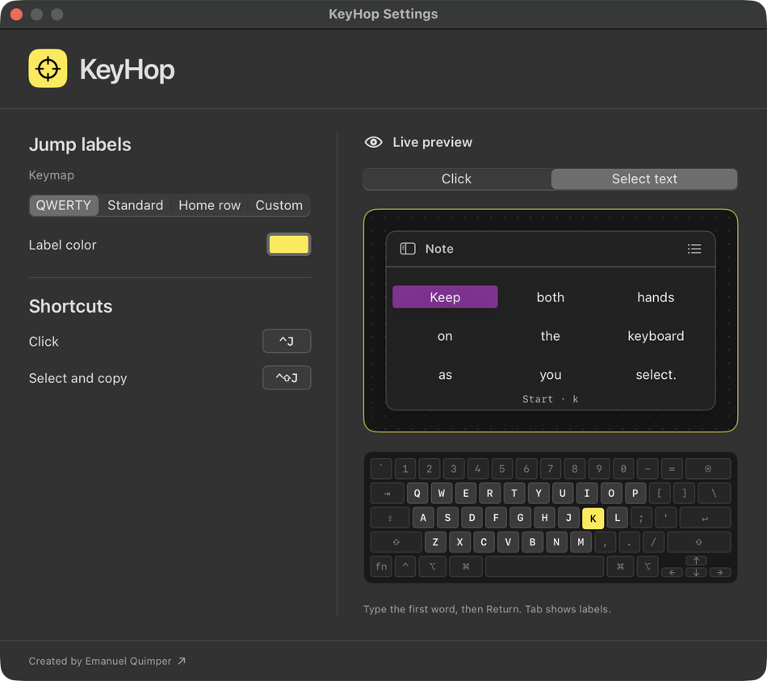

# KeyHop

KeyHop is a macOS menu bar app for clicking controls and selecting text with your keyboard. Press **⌃J** to put short labels on buttons and links in the active window. Type a label to click. Press **⌃⇧J** to choose the first and last words of a passage and copy it.

Read the [documentation](https://keyhop.equimper.com/docs/), or try it on the [website](https://keyhop.equimper.com).



## Install with Homebrew

KeyHop runs on Apple silicon and Intel Macs with macOS 14 or later. Install it from [Emanuel’s Homebrew tap](https://github.com/EQuimper/homebrew-tap) and open the app:

```sh
brew install --cask equimper/tap/keyhop
open -a KeyHop
```

Look for the crosshair in the menu bar. Choose **Settings…** to try the **Click** and **Select text** previews.

### Permissions

- **Accessibility** lets KeyHop receive its global shortcuts, inspect controls, and click or drag in the active app. Allow the KeyHop copy you launched under **System Settings → Privacy & Security → Accessibility**.
- **Screen Recording** (called **Screen & System Audio Recording** on some macOS versions) is requested the first time you select text. KeyHop captures the target window and recognizes visible words locally with Apple Vision. The image stays in memory.

If macOS asks you to restart KeyHop, quit it from the crosshair menu, then run `open -a KeyHop` again.

## Try it

**Click a control.** Open a window with a few buttons and press **⌃J**. If a button shows `jf`, type `j` and its label shrinks to `f`. Type `f` to click.

**Right-click.** Hold **Shift** while typing the last letter of a label. For `jf`, type `j`, then **Shift-F** to open the target’s context menu. When choosing a search result, a grouped marker, or a grid point, use **Shift-Return** instead.

**Copy a passage.** Press **⌃⇧J**. Type part of the first word and press **Return**. Type part of the last word and press **Return** again. The violet highlight previews the range. KeyHop performs the drag and invokes Copy in the original app. Paste with **⌘V**.

| While KeyHop is active | Keys |
| --- | --- |
| Find a control by name | In click mode, press `/`, type a name, then use ↑ or ↓ and Return. |
| Choose between matching words | Use ↑ or ↓ to cycle matches, or Tab to display labels and type one. |
| Pick a marker in a tight column | Type the label marked `›`, use ↑ or ↓ to highlight a marker, then Return to click. |
| Click any point in the window | Press Space in click mode. Use 1–9 to narrow the grid, with 1 at the top left and 9 at the bottom right. Return clicks the center. |
| Cancel | Press Esc. Switching apps also dismisses the overlay. |

The grid opens only when you press Space in click mode. Text selection works where a mouse drag can select text. Keep the window and its contents still while selecting. Dense columns and text inside images can yield different results from the preview because the host app determines what gets selected.

## Make it yours

Open **Settings…** from the crosshair menu to change either global shortcut, the label color, or the keymap. Both shortcuts are enabled across apps by default. You can pause them for the frontmost app from the menu.

| Keymap | How labels are assigned |
| --- | --- |
| **Standard** | Prioritizes the default letter order, beginning with `f j d k`. |
| **Home row** | Uses `a s d f g h j k l`. |
| **Custom** | Uses 2–26 different letters in the order you enter. Try the letters in the preview, then click **Apply**. |
| **QWERTY** | Maps positions in the window to keyboard rows. Upper-left targets use `q`, lower-left targets use `z`. Targets in the same region get distinct suffixes. |

Click inside **Live preview** to try your keys without leaving Settings. Its miniature keyboard highlights each physical key as you press it. The text preview lets you practice both endpoints without changing your clipboard.

## Development

To work on KeyHop, install the Xcode Command Line Tools (`xcode-select --install`) or Xcode with Swift 5.10 or newer. From the repository root, `make dev` builds and launches `dist/local/KeyHop.app`. This contributor copy uses an ad hoc signature. Quit the installed copy before testing global shortcuts, and grant Accessibility to the copy you are testing. macOS may ask again after a rebuild.

| Command | Result |
| --- | --- |
| `make dev` | Build and launch the local contributor copy. |
| `make test` | Run the Swift tests. |
| `make clean` | Clean build products and remove generated app bundles. |
| `make build` / `make run` | Build / build and launch the maintainer copy using Emanuel’s personal Developer ID certificate. |

The Swift package lives in [Sources/KeyHop](Sources/KeyHop), with tests in [Tests/KeyHopTests](Tests/KeyHopTests). For a shortcut or overlay change, run the tests and try the affected gesture in a real app. For an issue, include your macOS version, the target app, the shortcut you pressed, and what appeared on screen.

## License

Released under the [MIT License](LICENSE). Created by [Emanuel Quimper](https://equimper.com).
