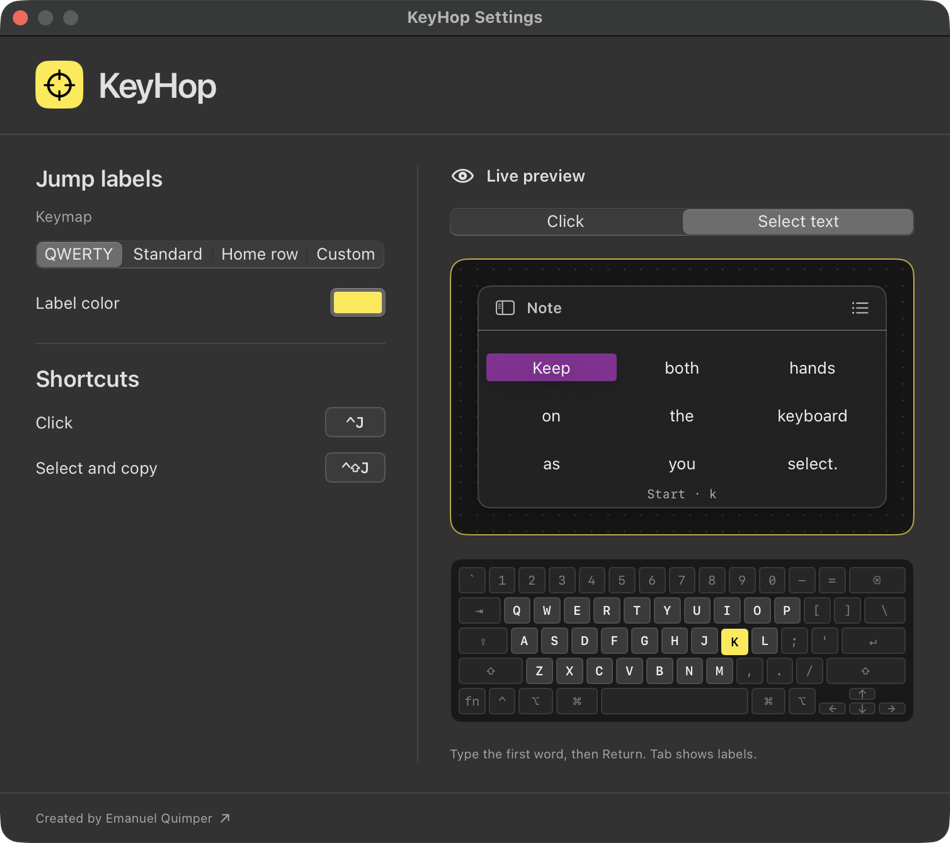

KeyHop is a macOS menu bar app. It puts short labels on the buttons and links in the active window, and you type a label to click. It can also select a passage of text by its first and last words, then copy it.

## Install

KeyHop needs macOS 14 or later and runs on Apple silicon and Intel Macs.

```sh
brew install --cask equimper/tap/keyhop
open -a KeyHop
```

Look for the crosshair in the menu bar. macOS asks for [Accessibility access](/docs/permissions/) the first time you open KeyHop. Allow it, or KeyHop can't receive its shortcuts.

## Click something

1. Open any window with a few buttons.
2. Press <kbd>⌃J</kbd>. Yellow labels appear on the window's controls.
3. Type a label. If a button shows <span class="hop">jf</span>, type <kbd>j</kbd> and the label shrinks to <span class="hop">f</span>. Type <kbd>f</kbd> to click.

Press <kbd>Esc</kbd> to cancel at any time.

## Copy a passage

1. Press <kbd>⌃⇧J</kbd>. The first time, macOS asks for [Screen Recording access](/docs/permissions/#screen-recording).
2. Type part of the first word and press <kbd>Return</kbd>.
3. Type part of the last word and press <kbd>Return</kbd> again.
4. Paste with <kbd>⌘V</kbd>.

## Practice in Settings

Choose **Settings…** from the crosshair menu. **Live preview** has a practice window for both **Click** and **Select text**, and a miniature keyboard that shows each key you press. Nothing there touches your clipboard.


